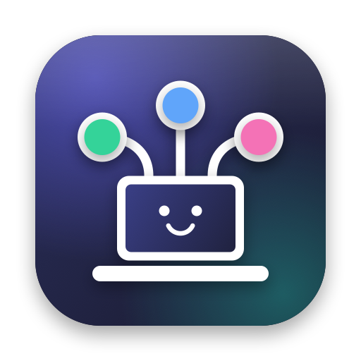
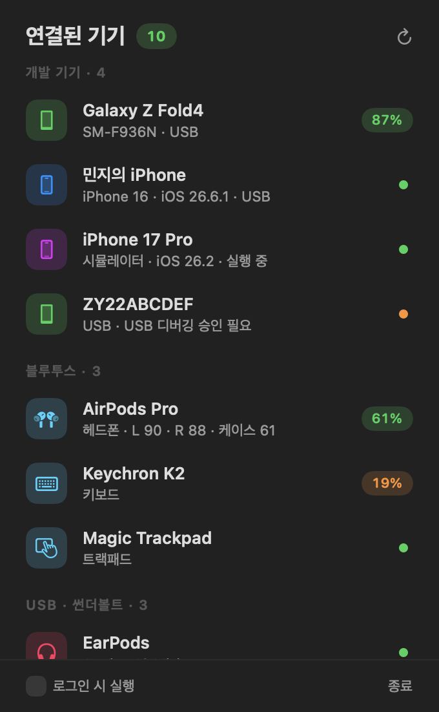
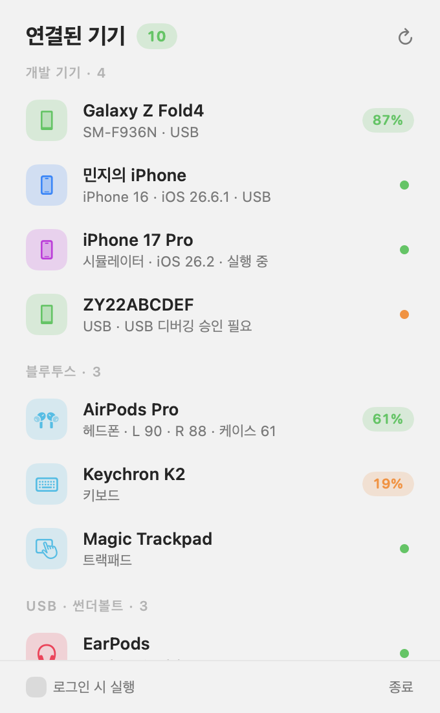

# Pluggy 🔌

> "지금 내 컴퓨터에 뭐가 붙어 있더라?" 를 1초 만에.

케이블 꽂은 폰, 블루투스 키보드, 어디 갔는지 모를 USB 허브까지.
Pluggy 는 컴퓨터에 연결된 기기를 한 줄로 세워서 보여 주는 작은 상주 앱이에요.
화면 구석에 조용히 앉아 있다가, 누르면 "네, 지금 이만큼 붙어 있어요" 하고 알려 줍니다.

  
  

## 이런 걸 해 줘요

- 📱 **개발 기기**: 안드로이드 폰·에뮬레이터, 아이폰·아이패드, iOS 시뮬레이터.
  `adb devices` 치러 터미널 열 일이 줄어요.
- 🎧 **블루투스**: 연결된 기기와 배터리 잔량.
  키보드가 회의 중에 꺼지기 전에 미리 알 수 있어요.
- 🔌 **USB · 썬더볼트**: 케이블로 꽂은 장치들.
- 🪫 **배터리 부족 알림**: 20% 아래로 내려가면 한 번만 살짝 알려 줘요. 계속 조르지 않아요. (맥)
- 📋 **눌러서 복사**: 행을 누르면 시리얼·UDID·주소가 복사돼요.

## 받기

[Releases](../../releases/latest) 에서 내 컴퓨터에 맞는 파일을 받아 압축을 풀면 끝이에요.

| 내 컴퓨터 | 받을 파일 | 사는 곳 |
|---|---|---|
| 맥 (애플 실리콘·인텔) | `Pluggy-macos.zip` | 메뉴바 |
| 윈도우 10/11 | `Pluggy-windows-x64.zip` | 트레이 |

### 처음 열 때 경고가 떠요 🙈

서명 비용을 아직 안 낸 작은 앱이라 그래요. 한 번만 넘기면 다음부터는 조용해요.

- **맥**: 응용 프로그램 폴더로 옮기고 한 번 연 뒤,
  시스템 설정 → 개인정보 보호 및 보안 → 「그래도 열기」
- **윈도우**: 「Windows의 PC 보호」 창에서 「추가 정보」 → 「실행」

> 윈도우용은 아직 미리보기예요. 빌드와 테스트는 통과했지만 실제 PC 에서
> 충분히 써 보지 못했어요. 이상한 점이 보이면 이슈로 살짝 알려 주세요 🙏

## 안 하는 것

- 같은 와이파이의 다른 기기 찾기
- 기기 연결 끊기·제어하기

Pluggy 는 보여 주기만 해요. 건드리지 않아요.

## 직접 고쳐 보고 싶다면

| 폴더 | 만든 것 | 자세히 |
|---|---|---|
| `macos/` | SwiftUI 메뉴바 앱 | [macos/README.md](macos/README.md) |
| `windows/` | .NET 8 트레이 앱 | [windows/README.md](windows/README.md) |
